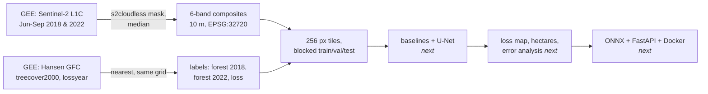
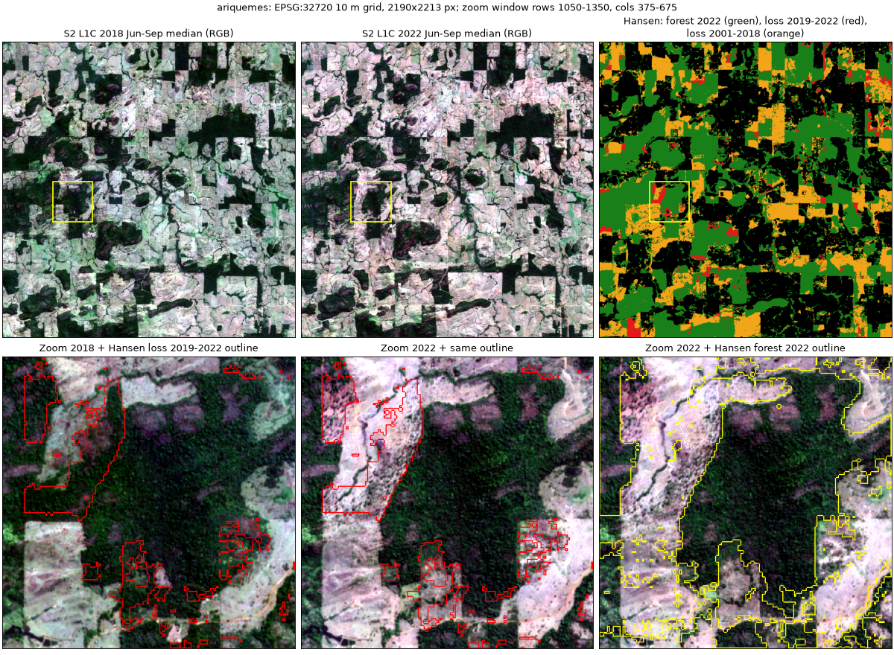

# Deforestation detection in Rondônia from Sentinel-2

Per-pixel forest mapping for **Ariquemes, Rondônia, Brazil** (bbox −63.0, −10.5, −62.8, −10.3) in **2018 and 2022**, built on real Sentinel-2 imagery and labelled with [Hansen Global Forest Change](https://glad.earthengine.app/view/global-forest-change). Forest loss is defined as forest(2018) AND NOT forest(2022). Every number in this README is generated from `reports/metrics/*.json` by [`scripts/readme_tables.py`](scripts/readme_tables.py).

> **Status: v2 is in progress on branch `v2-real-data`.** The data download, labels and spatial split are done. Baselines, the U-Net, change detection and deployment come next. The v1 "deforestation" results (IoU 0.975) were computed on synthetic scenes stitched from EuroSAT tiles and have been removed (see [PR #2](https://github.com/Nishchalam/Deforestation-detection/pull/2)).

## Pipeline



## Data

<!-- BEGIN:data -->
| | |
|---|---|
| Sentinel-2 collection | `COPERNICUS/S2_HARMONIZED` + s2cloudless cloud mask |
| Hansen GFC version | `UMD/hansen/global_forest_change_2025_v1_13` |
| Grid | EPSG:32720, 10 m, 2190 x 2213 px |
| Scenes 2018 (Jun-Sep) | 48 images / 24 dates; clear obs per pixel min 14, median 20 |
| Scenes 2022 (Jun-Sep) | 50 images / 24 dates; clear obs per pixel min 13, median 17 |
| Forest fraction 2018 / 2022 | 39.7% / 37.2% |
| Hansen loss 2019-2022 | 120,395 px = 1,204 ha |
<!-- END:data -->



The bottom row zooms into the yellow box. The red line traces the 2019–2022 Hansen loss: it sits on intact forest in 2018 and on clearings in 2022, which shows the imagery and labels share one grid.

### Spatial split

Whole 256×256 px tiles are assigned to a split. Test is one contiguous 3×3 block and val one 2×4 block that doesn't touch it, so test pixels aren't surrounded by training pixels ([why](https://doi.org/10.1111/ecog.02881)). The blocks are chosen by a fixed, label-only rule before any training ([`tiles.choose_split`](src/deforest/tiles.py)).

<!-- BEGIN:split -->
| Split | Tiles | Forest 2018 | Forest 2022 | Loss 2019-2022 |
|---|---:|---:|---:|---:|
| train | 47 | 40.5% | 38.2% | 2.31% |
| val | 8 | 39.7% | 37.5% | 2.20% |
| test | 9 | 40.4% | 38.4% | 1.98% |
| all | 64 | 40.4% | 38.1% | 2.25% |
<!-- END:split -->


## Data sources

- [Sentinel-2 L1C, harmonized](https://developers.google.com/earth-engine/datasets/catalog/COPERNICUS_S2_HARMONIZED) (ESA Copernicus), via [Google Earth Engine](https://earthengine.google.com/)
- [s2cloudless cloud probability](https://developers.google.com/earth-engine/datasets/catalog/COPERNICUS_S2_CLOUD_PROBABILITY) and the [masking recipe](https://developers.google.com/earth-engine/tutorials/community/sentinel-2-s2cloudless)
- [Hansen et al. Global Forest Change](https://storage.googleapis.com/earthenginepartners-hansen/GFC-2025-v1.13/download.html) ([paper](https://doi.org/10.1126/science.1244693))

## Setup

```bash
python3 -m venv .venv && source .venv/bin/activate
pip install torch --index-url https://download.pytorch.org/whl/cu128   # pick your CUDA/CPU build
pip install -r requirements.txt && pip install -e .
earthengine authenticate          # once per machine; set EE_PROJECT=<gcp-project> if needed
```

## Reproduce

```bash
python scripts/download_data.py --config configs/ariquemes.yaml --counts-only   # scene counts only
python scripts/download_data.py --config configs/ariquemes.yaml                 # GeoTIFFs -> data/raw/
python scripts/check_alignment.py --config configs/ariquemes.yaml               # alignment figure + data_stats.json
python scripts/make_labels.py --config configs/ariquemes.yaml                   # labels.tif
python scripts/make_tiles.py --config configs/ariquemes.yaml                    # split.json + figure
python scripts/readme_tables.py                                                 # refresh README tables
pytest
```

All settings are in [`configs/ariquemes.yaml`](configs/ariquemes.yaml). Data, imagery and weights are not committed.

## Design decisions

- **L1C instead of L2A for both years:** GEE has only 6 L2A dates for Jun–Sep 2018 here vs 24 for L1C, so L1C keeps processing and seasonal sampling identical across years ([`download_data.py --counts-only`](scripts/download_data.py)).
- **Dry-season median composite:** fewest clouds; the median rejects leftover cloud and shadow ([GEE compositing](https://developers.google.com/earth-engine/guides/ic_composite_mosaic)).
- **One shared UTM grid:** S2 and Hansen are requested on an identical 10 m grid snapped to the native S2 pixels, so labels line up pixel for pixel ([`gee.make_grid`](src/deforest/gee.py)).
- **Tiled `getDownloadURL` instead of Export to Drive:** the area is small (~60 MB), so synchronous 1024 px requests under the 32 MB cap keep the download a single scripted step ([limits](https://developers.google.com/earth-engine/apidocs/ee-image-getdownloadurl)).
- **Loss window 2019–2022:** it equals forest(2018) AND NOT forest(2022) under the label rule. Caveat: loss in Oct–Dec 2018 is missed and Oct–Dec 2022 is included.
- **Blocked spatial split:** avoids inflated scores from neighbouring, near-identical tiles ([Roberts et al. 2017](https://doi.org/10.1111/ecog.02881)).

## Limitations (so far)

- Labels come from Hansen, so agreement with Hansen is partly circular. An independent check against [PRODES](https://terrabrasilis.dpi.inpe.br/) is planned.
- Hansen has label noise: some pixels it calls forest in 2022 already look cleared (e.g. loss it records only in 2023 or later).
- L1C is top-of-atmosphere reflectance (no atmospheric correction). Both years are treated the same way.
- With 64 tiles, the test set is 9 tiles, so test metrics will have wide uncertainty.

## Legacy: EuroSAT CNN benchmark (v1)

The v1 project classified 64×64 [EuroSAT](https://github.com/phelber/eurosat) RGB patches into 10 land-cover classes with CNNs trained from scratch. Numbers come from the test-set metrics files in [`legacy/eurosat/`](legacy/eurosat/):

<!-- BEGIN:legacy -->
| Model | Test acc. | Macro P | Macro R | Macro F1 | img/s |
|---|---:|---:|---:|---:|---:|
| ResNet-18 | 96.04% | 0.960 | 0.960 | 0.959 | 276 |
| GoogLeNet | 87.00% | 0.880 | 0.869 | 0.868 | 139 |
| EfficientNet-B0 | 86.63% | 0.889 | 0.869 | 0.866 | 153 |
| AlexNet | 83.26% | 0.840 | 0.833 | 0.828 | 189 |
| LeNet-5 | 64.41% | 0.655 | 0.631 | 0.620 | 214 |
<!-- END:legacy -->

## License

[Apache 2.0](LICENSE)
